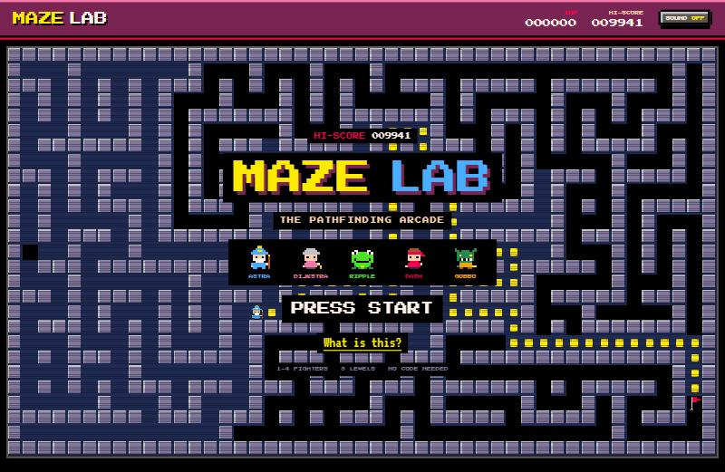
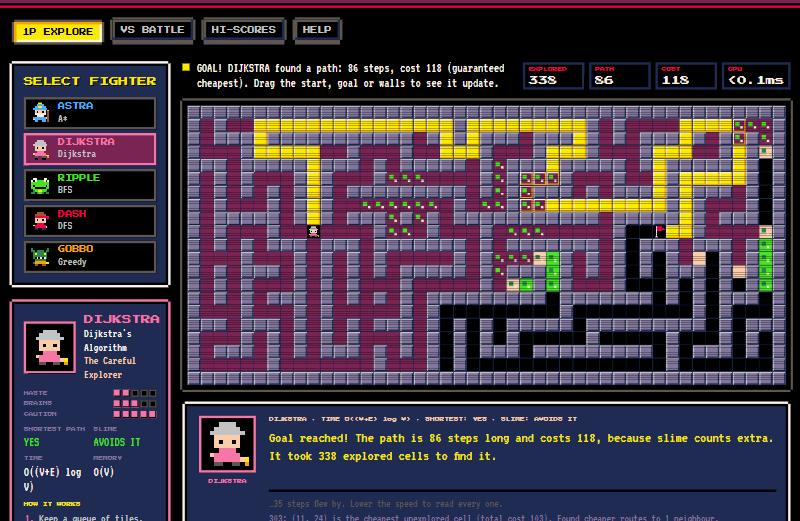
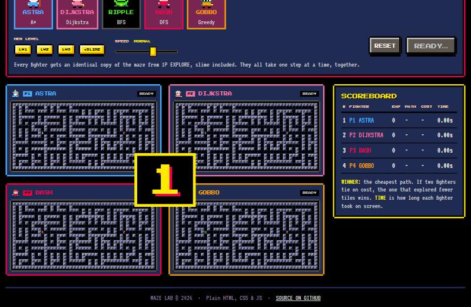
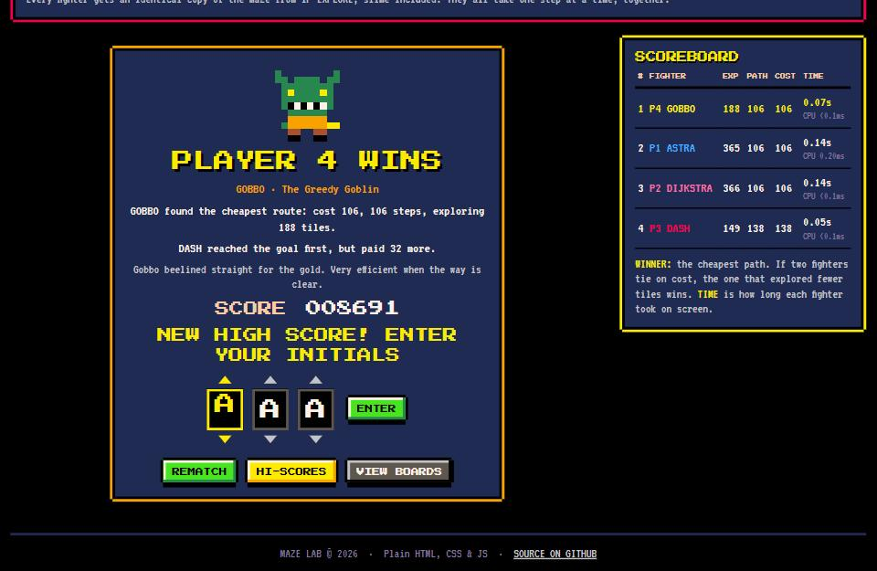

# MAZE LAB: The Pathfinding Arcade

**An 8-bit arcade game about how computers find their way.** Pick a fighter (each one is a real pathfinding algorithm), load a level, pour in some slime, and watch them search the maze tile by tile. Or throw 2–4 of them into a VS battle and put your initials on the high-score table.

**Play it:** https://parniyapeykamiyan.github.io/maze-lab/

Plain HTML, CSS and JavaScript (ES modules). No frameworks, no build step, no image files: every sprite is drawn in code and every sound is synthesised live.

## Screenshots

| Attract mode | 1P Explore |
|---|---|
|  |  |

| VS Battle countdown | Winner screen |
|---|---|
|  |  |

## The fighters

| Fighter | Algorithm | Personality | Shortest path? | Slime? | Time |
|---|---|---|---|---|---|
| **ASTRA** | A\* Search | The Clever One: cost so far plus an educated guess | Yes | Avoids it | O(E log V) |
| **DIJKSTRA** | Dijkstra's Algorithm | The Careful Explorer: always expands the cheapest tile | Yes | Avoids it | O((V+E) log V) |
| **RIPPLE** | Breadth-First Search | The Patient Frog: explores ring by ring | Fewest steps | Wades in | O(V+E) |
| **DASH** | Depth-First Search | The Reckless Runner: dives deep, backtracks at dead ends | No | Wades in | O(V+E) |
| **GOBBO** | Greedy Best-First | The Greedy Goblin: heads for whatever looks closest | No | Wades in | O(E log V) |

*V = tiles, E = connections between tiles (about 4V on a grid).*

## Features

- **Attract mode**: the title flashes, a demo maze carves and solves itself (each fighter takes a turn walking the coin trail), and PRESS START blinks. A clearly visible **"What is this?"** link explains it all for non-coders.
- **1P Explore**:
  - Draw walls and slime by clicking and dragging (touch works too), and drag the fighter or the goal flag anywhere.
  - Adjust the speed from a crawl to ludicrous, and pause or step one move at a time.
  - After a run, any edit recomputes the result instantly.
- **Levels**: Level 1 is random walls, Level 2 is recursive backtracking, Level 3 is randomised Prim's. All three animate as they generate.
- **Slime tiles**: cost 5 to step into. Only Astra (A\*) and Dijkstra route around them. The others wade straight through, and the stats show the true cost they paid.
- **VS Battle**:
  - 2–4 fighters race in lockstep on identical copies of the maze, after a 3, 2, 1, GO! countdown.
  - A live scoreboard tracks tiles explored, path length, cost and time.
  - The winner screen announces "PLAYER N WINS". The cheapest path wins, and ties go to whoever explored fewer tiles.
- **High scores**: the winner scores *path efficiency × 10000* (path tiles ÷ tiles explored) plus 1000 per rival. You enter 3-letter initials arcade-style, and the table is saved in `localStorage`.
- **HINT box**: an RPG dialogue window where your fighter narrates every move, typed out letter by letter. It also shows how the algorithm works, its time complexity, and whether it guarantees the shortest path.
- **Chiptune sound effects** via the Web Audio API: blips while exploring, a jingle when the path is found, countdown beeps and a victory fanfare. **Sound is OFF by default**; toggle it in the top bar.
- Works on phones.

### The look

- A fixed 16-colour palette (PICO-8) used for every colour on the site.
- *Press Start 2P* for titles and buttons, *VT323* for body text.
- Hard pixel borders and chunky 3D buttons that press down.
- `image-rendering: pixelated` everywhere.
- Every animation is choppy, using `steps()`.
- CRT scanlines only on the game screens.

## Running locally

ES modules need to be served over HTTP, so opening `index.html` straight from disk won't work. Any static server will do:

- **VS Code**: install *Live Server*, right-click `index.html` and pick **Open with Live Server**.
- **Node**: `npx serve .`
- **Python**: `python -m http.server`

## Project structure

```
index.html          the cabinet: marquee/HUD, attract, 1P explore, VS, hi-scores, help
css/styles.css      8-bit theme: palette, pixel buttons/windows, tiles, steps() animations
assets/             favicon + README screenshots
js/
  main.js           boots everything: screen switching, sound toggle, speed, HUD
  grid.js           board model + DOM rendering + mouse/touch editing; gridGraph() adapter
  algorithms.js     the five algorithms as step-yielding generators
  mazes.js          level generators as step-yielding generators
  animator.js       rate-controlled stepper (play / pause / step / stop)
  ui.js             1P Explore controller: roster, levels, stats, live recompute
  race.js           VS battle: countdown, lockstep runner, scoreboard, winner + initials
  explain.js        fighter personas + summaries, HINT box typewriter, help-screen bios
  sprites.js        the palette and the pixel-art sprites (2-frame walk cycles)
  sound.js          Web Audio chiptune effects
  scores.js         high-score table (localStorage) and initials picker
  attract.js        the self-solving demo maze behind the title screen
```

### How it fits together

Algorithms never touch the DOM. They receive a small **graph interface**:

```js
{ size, start, end, neighbors(id), cost(id), heuristic(id), isMud(id), label(id) }
```

and **yield** one step at a time (`{ type: 'visit', id, frontier, msg }`, then `{ type: 'done', path, cost, ... }`). The `Animator` consumes those steps at whatever speed you pick. That one design powers pausing, single-stepping, the HINT narration, lockstep VS battles and the attract-mode demo.

It also keeps the door open for the planned next phases:

- **Street-map mode**: write a `neighbors/cost/heuristic` adapter over real road data, and every fighter works unchanged.
- **Race-the-algorithm game mode**: the step stream lets a player's moves be compared with a fighter's, tick for tick.
- **3D mode**: a new renderer can subscribe to the same step stream the board uses today.
